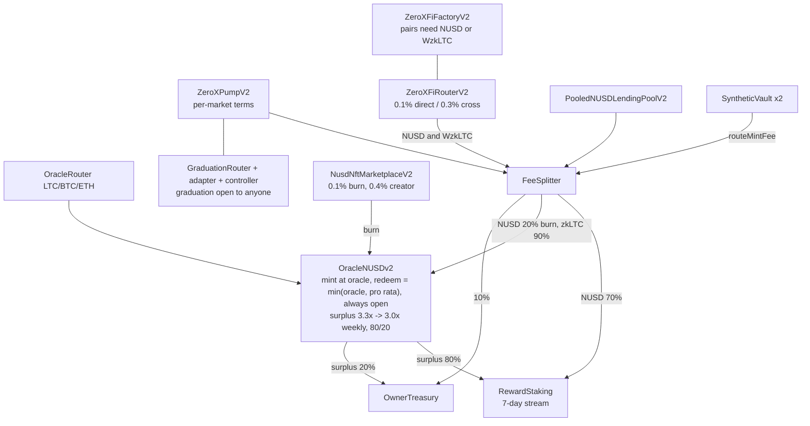

# Testnet architecture

## Product boundary

One Next.js app (`apps/web`) serves every product on LitVM LiteForge (chain id `4441`, native gas token zkLTC):

| Product | Routes | What it is |
| --- | --- | --- |
| 0xFi | `/0xFi`, `/0xFi/swap`, `/0xFi/pools` (`/create`, `/[pair]`), `/0xFi/lend`, `/0xFi/borrow`, `/0xFi/earn`, `/0xFi/farm`, `/0xFi/synth`, `/0xFi/rwa` | DEX, pooled NUSD lending, nBTC/nETH synths, LP farms, RWA markets (`shared/rwa/markets.json` lists none yet) |
| 0xPump | `/0xPump`, `/0xPump/create`, `/0xPump/token/[token]`, `/0xPump/portfolio`, `/0xPump/stats` | NUSD bonding-curve launchpad that graduates into 0xFi |
| NUSD | `/nusd` (mint, redeem, emergency exit), `/nusd/earn` (stake, claim, distribute fees) | Oracle-priced stable backed by zkLTC |
| 0xPixel | `/0xpixel`, `/0xpixel/gallery`, `/0xpixel/marketplace` (`/nusd`) | On-chain pixel-art NFTs and the NUSD NFT marketplace |

`/docs` is the in-app guide; integrator documentation is in `docs/developers/`.

0xPixel remains the existing onchain pixel-art NFT collection: new artwork mints to the V2 collection (`PIXEL_NFT_ADDRESS` in `apps/web/lib/publicConfig.ts`), and the Classic collection stays readable. Both trade on the NUSD marketplace (`NUSD_NFT_MARKETPLACE.md`). The retired native-zkLTC marketplace is paused (`deployments/liteforge-testnet/legacy-marketplace-pause.json`); sellers there can only revoke approval.

0xPump is a separate NUSD launchpad. It does not depend on the removed legacy DEX.

# Tokenomics v3 (active set since 2026-10-15)

The deployed set is v3 (`deployments/liteforge-testnet/v3.json`, with the per-root Forge outputs `contracts/deployments/v3-core.json` and `0xFi/contracts/deployments/v3-fi.json`; the web reads `apps/web/features/fi/config/testnet.generated.json`; rules and owner powers in `TOKENOMICS.md`). Every fee flows to one permanent `FeeSplitter`: NUSD splits 70% to stakers (`RewardStaking`, streamed over 7 days), 20% burned, 10% to the owner-spent `OwnerTreasury`; zkLTC splits 90% into the NUSD reserve and 10% to the treasury. `harvest()` collects every registered source and runs inside each stake and claim. Prices come through `OracleRouter`s whose source the owner can replace within a 25% deviation check, so NUSD, lending and the synths never need redeploying for a new feed.

`ZeroXFiPair`, `WzkLTC`, the DIA adapters, `SyntheticAsset`, `SynthSafetyReserve`, gauges, the LP locker and the metadata registry keep their v1 code; WzkLTC and the adapters are the same deployed instances, now behind the routers. The sections below describe the shared mechanics; where they mention v1-only behaviour (owner fee withdrawal, platform fee, xPoints) v3 replaces it as above.

# OracleNUSDv2 and DIA

DIA is the price source; it does not mint NUSD. The live NUSD is `OracleNUSDv2`
(`contracts/src/nusd/OracleNUSDv2.sol`), both the ERC-20 (18 decimals) and the
native-zkLTC reserve. It prices every mint and redeem through the LTC
`OracleRouter`, which reads a DIA adapter, tracks recognized native backing in
`totalCollateralWei`, and exposes itself from `vault()` so the 0xPump
constructor interface remains compatible. 0xPump only transfers NUSD for
creation fees and curve trades; it has no mint or reserve authority.

`mintAtOracle(minNusdOut, recipient)` mints `quoteMint(msg.value)`: the oracle
value of the deposit minus `mintFeeBps`. `redeemAtOracle(amountNusd,
minCollateralOutWei, recipient)` pays `quoteRedeem(amountNusd)`: the lower of
`amountNusd * 1e18 / priceWad` and the holder's pro-rata share
`amountNusd * totalCollateralWei / totalSupply`, minus `redeemFeeBps`, so an
under-backed reserve is shared evenly instead of first come, first served. Mint
and redeem fees are zero on the live deployment (owner-bounded at 0.5%,
`MAX_FEE_BPS = 50`, kept in the reserve). There is no user debt position,
collateral ratio, or liquidation path. The supply ceiling limits `totalSupply`
(a mint that takes usage to 80% doubles it, at most once every 7 days), and
burned supply restores headroom. `coverReserve` can add recognized backing
without minting; there is no administrator reserve sweep.

This is an oracle-priced reserve model, not an overcollateralized stablecoin.
A decline in zkLTC/USD after minting can make reserve value lower than NUSD
supply, while a rise can create reserve surplus. Stale or invalid oracle data
blocks both value-changing paths. Only minting can be paused (`mintPaused`);
redemption is always open, and quote reads and reserve coverage remain
available. If the oracle cannot price, anyone can call `reportOracleFailure`;
7 days later `emergencyRedeem` pays the pro-rata zkLTC share without a price.

The v3 NUSD does not migrate balances or collateral from earlier NUSD
deployments or the legacy `NativeCollateralVault`. Their addresses remain only as
historical deployment-manifest fields and are not exposed by the web app.

## Pump lifecycle

Each token starts in `TRADING`. Its full fixed supply is held by the launchpad and sold or bought back through virtual constant-product reserves.

- Each market keeps the terms it was created with (`ZeroXPumpV2` `MarketParams`); the parameter admin can change terms only for markets created later, bounded by `MAX_CREATE_FEE_NUSD = 100e18` and `MAX_TRADE_FEE_BPS = 100`.
- With the current terms, reserving a market costs `1e18` NUSD units before any hosted IPFS upload, and every buy and sell charges `10` basis points (`0.1%`). Read `createFee()` and `marketParams(token)` rather than hard-coding them.
- Slippage limits and deadlines are mandatory.
- Logo and metadata references use canonical `ipfs://` URIs.
- Authoritative post-trade reserves are emitted for the subgraph.

The on-chain READY gate is the real NUSD reserve: a buy moves the market to
`READY` when `realNusdReserve + curveNusdAmount >= graduationReserveThresholdNusd`
(`1,500 NUSD` with the release parameters). The `6,000 NUSD` market cap
(`spotPriceNusdWad * fixedTotalSupply / 1e18`) is the target that reserve
threshold is derived from, and it is guaranteed to be reached at that point. It
is not a `6,000 NUSD` real reserve target. With the release parameters, the initial virtual market cap is
`1,500 NUSD` and the curve derives a `1,500 NUSD` real-reserve target that lands
on the `6,000 NUSD` market-cap boundary. `curveProgressBps` measures progress
toward that derived reserve target.

At the target, the market moves to `READY` and further buys stop. No DEX call
occurs inside the target-crossing buy. The router was deployed disabled and
without an adapter; the delayed 0xFi adapter activation and both admin handovers
have since completed on testnet, so the controller's permissionless graduation
path is active. `pump.graduation` in
`deployments/liteforge-testnet/deployments.json` records that state, but no
manifest field gates the UI: for a `READY` market the client recomputes
`operational` from live reads and fails closed unless the controller owns Pump
admin, Pump points at the pinned router, controller and router agree on the
pinned adapter, the router's admin is the controller, `graduationsPaused` is
false, `enabled` is true, and `isAdapterAllowed` is true.
Holders retain an exit regardless: the first successful sell
from `READY` atomically returns the market to `TRADING` and emits
`TokenCurveReopened`.

With that path live, anyone may ask the controller to graduate a READY
market. It derives the exact terminal token/NUSD amounts, atomically prepares an
empty protected 0xFi pair, pins the expected LP output, and routes LP tokens to
the permanent locker. A caller cannot select the adapter, pool, reserves,
recipient, price, or slippage. `GRADUATED` is terminal. Mainnet still requires
independent review of the adapter, DEX, terminal-price continuity, and liquidity
lock assumptions before this testnet topology is reused.

## Read paths

- Live balances, allowances, quotes, and market state come from RPC (`lib/rpcTransport.ts` falls back from `LITVM_RPC_URL` to `LITVM_RPC_FALLBACK_URL`).
- Freshness: `components/LiveSync.tsx` subscribes over WebSocket (`LITVM_WS_URLS`, tried in order) to logs from every protocol contract in the active set plus the contracts the mounted views read, and refetches the affected live queries as soon as an event arrives. A block sweep (`BLOCK_SYNC_MS = 10_000` plus jitter, `lib/liveData.ts`) still refreshes time-dependent reads, and is the whole mechanism while the socket is down.
- Token discovery, trades, candles, and aggregate history come from the Goldsky subgraphs (0xPump `zeroxpump-testnet/1.0.0`, 0xFi `zeroxfi-testnet/1.0.0`, NUSD marketplace `pixel-nusd-market/1.1.0`).
- API responses retain an RPC fallback shape when indexing is unavailable.
- 0xPixel keeps its existing subgraph-first and onchain-fallback behavior.

## IPFS

The web server uploads validated logo files and canonical metadata JSON to Pinata Public IPFS. `PINATA_JWT` is server-only. Before upload, the creator pays the nonrefundable `1 NUSD` fee into an owner-scoped reservation. The reservation hash commits to chain, Pump address, owner, canonical form fields, MIME type, byte length, and the file digest. The server recomputes that hash and checks the live reservation, so a copied hash cannot consume another wallet's reservation and changed content requires a new paid reservation. A successful market creation consumes the reservation; the same exact content remains retryable after a failed upload or transaction.

The versioned hash is `keccak256(abi.encode(...))` over these exact types and values, in order: `string "0xPump Market Content"`, `uint256 1`, `uint256 chainId`, `address factory`, `address owner`, trimmed `string name`, trimmed-uppercase `string symbol`, trimmed `string description`, trimmed `string website`, trimmed `string twitter`, trimmed-lowercase `string MIME type`, `uint256 file length`, and `bytes32 keccak256(file bytes)`.

Contracts store `ipfs://` values, while the UI derives gateway URLs at read time. Direct contract callers may bring their own already-pinned IPFS URIs, but they must still pay and consume a reservation.
