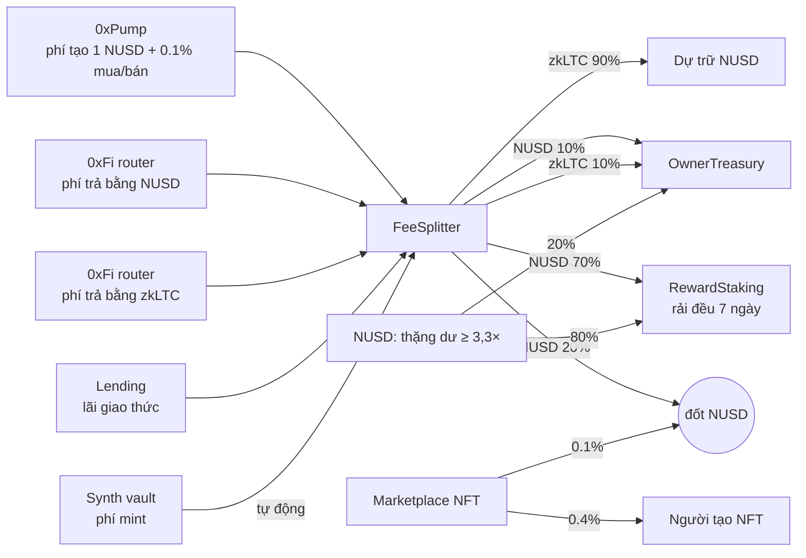

# Tokenomics v3 (testnet, triển khai 15/10/2026)

Bộ v3 thay hẳn bộ v2 trên LiteForge 4441. v2 vẫn còn trên chain nhưng web, ví và subgraph không dùng nữa, và không có chuyển đổi người dùng. Địa chỉ đầy đủ, block deploy và giao dịch tạo contract nằm trong `deployments/liteforge-testnet/v3.json`.

## Nguyên tắc

1. **Lõi bất biến.** NUSD, vị thế stake, curve Pump, pair AMM và escrow marketplace không có proxy, không ai sửa được code.
2. **Không phụ thuộc quy mô.** Mọi luật tính theo tỷ lệ phần trăm hoặc tỷ lệ bảo chứng; không còn con số tuyệt đối kiểu "vòng 10,000 NUSD".
3. **Thay đổi chỉ tác động về sau.** Ví owner chỉnh được một số tham số trong giới hạn cứng của contract. Market Pump giữ điều khoản lúc tạo, vị thế stake không bao giờ bị sửa, nguồn giá đổi được mà không phải deploy lại NUSD, synth hay lending.
4. **Tự vận hành.** Mỗi lần stake hoặc claim đều thu phí đang chờ, nên hệ thống chạy được nhờ hoạt động bình thường của người dùng, không cần owner.

## Dòng tiền



`FeeSplitter` là địa chỉ nhận phí duy nhất và không đổi. `harvest()` (ai cũng gọi được; mỗi lần stake/claim cũng tự gọi) kéo phí từ 4 nguồn đã đăng ký: Pump, phí NUSD và phí WzkLTC của router, lãi lending. Sau đó nó thử nhả thặng dư NUSD rồi chia. Nguồn nào lỗi thì bỏ qua, không chặn nguồn khác.

## Luật

| Phần | Luật |
| --- | --- |
| Mint NUSD | zkLTC trị giá 1 USD theo oracle mint 1 NUSD. Phí mint mặc định 0, tối đa 0.5%, và phí nằm lại trong dự trữ. Owner có quyền tạm dừng mint |
| Redeem NUSD | Trả **min(giá oracle, phần tỷ lệ của dự trữ)**. Khi đủ bảo chứng thì đúng 1 USD; khi thiếu thì mọi người chịu cùng một tỷ lệ, nên không có cuộc đua rút trước, và NUSD tự về 1 USD khi LTC hồi. **Không ai tạm dừng được redeem** |
| Oracle chết | Ai cũng báo lỗi oracle được. Sau 7 ngày oracle vẫn chết, người giữ đốt NUSD để lấy phần zkLTC theo tỷ lệ |
| Trần cung | 1,000,000 NUSD. Tự nhân đôi khi cung sau lần mint đạt ≥ 80% trần, tối đa 1 lần/7 ngày. Owner chỉnh được nhưng không thấp hơn cung hiện có |
| Thặng dư | Khi dự trữ ≥ **3,3×** cung, ai cũng gọi `releaseSurplus()` để mint phần dư về đúng **3,0×**, tối đa 1 lần/7 ngày: **80% người stake / 20% quỹ** |
| Phí NUSD | 70% người stake / 20% đốt (tăng bảo chứng) / 10% quỹ |
| Phí zkLTC | 90% vào dự trữ NUSD / 10% quỹ |
| Stake (0xPoints) | Khóa NUSD 30/90/180/365 ngày, trọng số ×1 / ×1.2 / ×1.5 / ×3. Mọi NUSD đi vào contract được rải đều trong 7 ngày theo trọng số. Khi không ai stake, dòng thưởng tạm dừng và giữ nguyên chứ không mất. Thưởng không hết hạn. Rút gốc khi đáo hạn và không bao giờ phụ thuộc phí. `claimAndStake` khóa thưởng thành vị thế mới |
| 0xPoints | Trọng số × thời gian, tích suốt đời. 1 0xPoint = 1 NUSD (đã nhân hệ số) giữ trong 1 ngày |
| 0xPump | Phí tạo 1 NUSD, phí giao dịch 0.1%, dự trữ ảo 1,500 NUSD, mục tiêu vốn hóa 6,000 NUSD (dự trữ thật 1,500). Owner chỉnh được cho market **mới**: phí tạo ≤ 100 NUSD, phí giao dịch ≤ 1%, curve kiểm tra như constructor. Market đã tạo giữ nguyên điều khoản của nó |
| Phí swap 0xFi | LP 0.5% mỗi chặng. Phí giao thức 0.1% khi một đầu là NUSD/zkLTC, 0.3% khi swap chéo qua NUSD/zkLTC |
| Marketplace 0xPixel | 0.1% giá bán bị đốt, 0.4% cho creator. Không có phí nền tảng |
| Oracle router | Mỗi tài sản (LTC, BTC, ETH) có một router làm địa chỉ giá cố định. Owner đổi được nguồn: nguồn mới phải có giá ngay; nếu nguồn cũ còn sống thì hai giá chỉ được lệch ≤ 25%; nguồn cũ đã chết thì đổi tự do |

## Quyền của owner (`0x5863…0000`)

Không có timelock. Mọi giới hạn nằm cứng trong contract.

| Contract | Owner làm được | Owner không làm được |
| --- | --- | --- |
| OwnerTreasury | Rút mọi token và zkLTC trong quỹ (đổi owner theo 2 bước) | — |
| NUSD | Tạm dừng mint; phí mint/redeem ≤ 0.5%; trần cung (≥ cung hiện có); ngưỡng thặng dư (sàn ≥ 1,5×, kích hoạt ≥ sàn + 0,1×); bên nhận thặng dư (quỹ ≤ 20%) | Dừng redeem, chặn lối thoát khi oracle chết, mint ngoài luật, động vào dự trữ |
| OracleRouter (LTC/BTC/ETH) | Đổi nguồn giá (giới hạn 25% khi nguồn cũ còn sống) | Đặt giá tùy ý |
| FeeSplitter | Tỷ lệ chia (quỹ ≤ 20%), bên nhận, danh sách tối đa 8 nguồn phí (không được trỏ vào tài sản hay bên nhận) | Rút phí đang nằm trong splitter |
| RewardStaking | Không có quyền gì | — |
| Pump | Điều khoản cho market mới (qua `paramAdmin`); tạm dừng tạo/mua qua graduation controller (bán luôn mở) | Rút phí, sửa market đã tạo |
| Router, factory, lending, synth, marketplace | Như v2: tạm dừng, cấu hình rủi ro, bật/tắt collection | Rút phí, rút lãi giao thức, động vào escrow |

## Địa chỉ chính

| Contract | Địa chỉ |
| --- | --- |
| NUSD | `0x69320A82ACCeC1b8A5EF59fd02b217e7ea4aEa19` |
| RewardStaking | `0x59589d9a5840D2CEF7A6e4A8cB55C258cc73E483` |
| FeeSplitter | `0xAea1Ef82Dbe800BB3683009630813457D990a9B0` |
| OwnerTreasury | `0xC5353F677E69c3386c752ab3b3FD7CA2c9372052` |
| 0xPump | `0x0239baEc3c695A6EA893Ad90a7608112e0580526` |
| Oracle router LTC / BTC / ETH | `0xf9CCF611b7c4e642852D3d1a7A6C3883985A2962` / `0xacB29CD8e1d7A206133bD4409b744d7C621c4535` / `0xc8Df5A07a2aB6c98694ee77ADf1DD4eC26541677` |
| 0xFi router | `0x1cda4793122a223A09be54ED5f664ba222eEe042` |

## Vận hành

```bash
npm --prefix 0xNothing-zkLTC-Testnet/0xFi run deploy:v3:status
```

```bash
forge test --root 0xNothing-zkLTC-Testnet/contracts --match-contract TokenomicsSmokeForkTest
```

Fork smoke test cần biến `LITVM_RPC_URL` và không gửi giao dịch nào. Nó kiểm tra cách nối dây của bộ đang chạy, rồi đi trọn một vòng trên bytecode thật: phí Pump → harvest → dòng thưởng → claim → rút gốc → redeem, và thặng dư 80/20 khi LTC tăng mạnh.

Quy trình deploy (`0xFi/scripts/deploy-v3.mjs`):

- `--rehearse`: chạy toàn bộ trên fork anvil, có smoke test.
- `--broadcast`: deploy và seed thanh khoản; có thể chạy tiếp từ giai đoạn đang dở.
- `--activate`: mở graduation sau 1 giờ.
- `--publish`: chuyển cấu hình mạng, subgraph, web và `deployments.json` sang v3.

v3 đã broadcast. **Không chạy lại `--broadcast`.**
