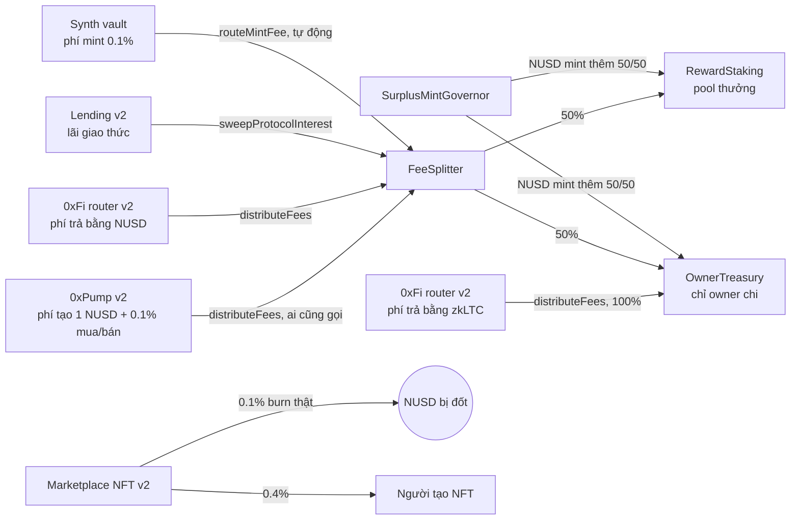

# Tokenomics v2 (testnet, triển khai 14/10/2026)

Bộ v2 là một bộ contract mới trên LiteForge 4441. v1 vẫn còn nguyên trên chain nhưng web không dùng nữa, và không có chuyển đổi người dùng (đúng quyết định "testnet không cần chuyển người dùng"). Địa chỉ đầy đủ và block deploy nằm trong `deployments/liteforge-testnet/v2.json`.

## Dòng tiền



Không có admin nào rút được phí. Mọi nguồn phí đều được "đẩy" đi bằng một lời gọi ai cũng thực hiện được (trang Earn có bảng "Revenue and treasury" với nút Send). Chỉ quỹ `OwnerTreasury` là do ví owner chi tiêu.

## Luật

| Phần | Luật |
| --- | --- |
| Phí swap 0xFi | LP giữ 0.5% mỗi chặng. Phí giao thức trả bằng NUSD hoặc zkLTC, thu ở NUSD/zkLTC đầu tiên trên đường đi: **0.1%** nếu một đầu là NUSD hoặc zkLTC, **0.3%** khi swap chéo TOKEN1 → NUSD/zkLTC → TOKEN2. `amountOutMin` được kiểm tra sau khi trừ phí |
| Token hợp lệ | Factory v2 chỉ cho tạo pair có NUSD hoặc WzkLTC, nên mọi token có thanh khoản đều hợp lệ cho swap chéo |
| Mint/redeem NUSD | 0% phí, theo giá DIA |
| Marketplace 0xPixel | 0.1% giá bán bị **burn** (tổng cung NUSD giảm), 0.4% cho creator (người nhận ERC-2981). Không có phí nền tảng. Người bán là creator thì nhận cả phần creator |
| 0xPoints | Stake NUSD khoá 30/90/180/365 ngày (×1 / ×1.2 / ×1.5 / ×3). Điểm tích theo từng giây: NUSD × hệ số. 1 0xPoint = 1 NUSD (đã nhân hệ số) giữ trong 1 ngày |
| Vòng thưởng | Khi pool có ≥ 10,000 NUSD chưa phân bổ và vòng đã kéo dài ≥ 1 ngày, **ai cũng** bấm "Close round" được. Đúng 10,000 NUSD chia theo tỷ lệ 0xPoints của vòng; điểm về 0 cho vòng mới; phần dư chuyển sang vòng sau. Thưởng không hết hạn; gốc luôn rút được khi đáo hạn |
| Vote mint thặng dư | Khi giá trị zkLTC dự trữ ≥ **3×** tổng cung NUSD: đề xuất, bỏ phiếu 3 ngày, thông qua khi phiếu thuận nhiều hơn chống và có ≥ 10 người. Lúc settle kiểm tra lại 3× với giá mới, rồi mint đến đúng **2×**; NUSD mới chia 50% pool / 50% quỹ. Mỗi phiếu khoá 100 NUSD đến hết vote, sau đó trả lại kèm 1–10 NUSD từ ngân sách 3,000 NUSD |
| Oracle chết | NUSD v2 có lối thoát: ai cũng báo lỗi oracle; sau 7 ngày oracle vẫn chết, người giữ NUSD đốt NUSD để lấy phần zkLTC theo tỷ lệ (bỏ qua cả `redeemPaused`) |

## Giới hạn cần biết

- **Sybil:** "≥ 10 người, mỗi người khoá 100 NUSD" nghĩa là một người có 10 ví và 1,000 NUSD vẫn tự thông qua được một vote. Rủi ro này được chặn bởi điều kiện 3× (vote chỉ mở khi dự trữ dư thật) và việc contract tự kiểm tra lại 3×/2× khi mint. Phần thưởng 1–10 NUSD dùng `prevrandao`, không phải ngẫu nhiên an toàn; ngân sách bị giới hạn 3,000 NUSD.
- **Ngân sách khuyến khích chưa được nạp.** Ví deployer chỉ có khoảng 3.5 zkLTC sau khi deploy. Ai cũng nạp được (trang Vote → "Fund incentives"), tổng tối đa 3,000 NUSD.
- **Pool thưởng đầy dần theo phí thật.** Ở quy mô testnet hiện tại, để có 10,000 NUSD cần rất nhiều giao dịch. Owner có thể chuyển NUSD từ quỹ vào `RewardStaking` để khởi động vòng đầu; contract coi mọi NUSD dư so với gốc và thưởng đã phân bổ là pool.
- Subgraph trên Goldsky chỉ còn bản mới: `zeroxpump-testnet/1.0.0`, `zeroxfi-testnet/1.0.0`, `pixel-nusd-market/1.1.0` (project `cmqmpust…`). Subgraph Pump xử lý cả sự kiện phí của mainnet để giữ bản mirror giống hệt.

## Quyền của owner (`0x5863…0000`)

| Contract | Owner làm được | Owner không làm được |
| --- | --- | --- |
| OwnerTreasury | Rút mọi token và zkLTC trong quỹ (đổi owner theo 2 bước) | — |
| NUSD v2 | Pause mint/redeem | Chặn emergency exit, mint thêm, đổi governor (đã gắn vĩnh viễn) |
| RewardStaking, FeeSplitter, SurplusMintGovernor | Không có quyền gì | — |
| Router v2 | Không có quyền gì | Rút phí |
| Factory v2, lending v2, synth vault | Pause, cấu hình rủi ro (như v1) | Rút lãi giao thức |
| Marketplace v2 | Pause, bật/tắt collection | Rút credit/escrow, đổi phí |
| Pump v2 | Qua graduation controller: pause tạo/mua (bán luôn mở) | Rút phí |

## Vận hành

```bash
npm --prefix 0xNothing-zkLTC-Testnet/0xFi run deploy:v2:status
```

```bash
forge test --root 0xNothing-zkLTC-Testnet/contracts --match-contract V2TokenomicsSmokeForkTest
```

Fork smoke test cần biến `LITVM_RPC_URL` và không gửi giao dịch nào. Test chạy trên bộ v2 đang hoạt động: phí router và Pump vào pool/quỹ, một vòng thưởng trọn vẹn, marketplace burn và trả creator, vote mint thặng dư về 2×.

Quy trình deploy (`0xFi/scripts/deploy-v2.mjs`): `--rehearse` chạy toàn bộ trên fork anvil, `--broadcast` deploy và seed thanh khoản, `--activate` mở graduation sau timelock 1 giờ, `--publish` chuyển cấu hình của repo sang v2.
